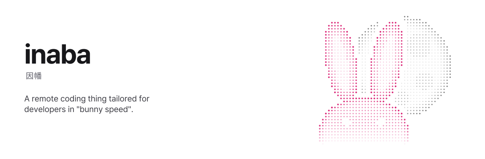

<p align="center">
  
</p>

<p align="center">
  <a href="#what-is-blocked-by-y-combinator"></a>
</p>

<a href="https://en.touhouwiki.net/wiki/Tewi_Inaba"><code>inaba</code></a> <sup>(因幡)</sup> is a remote coding thing tailored for developers in "bunny speed".  
It runs coding agents on **your own** machines and lets you drive them from whatever browser you have around. Start something on your desktop, hand the keyboard to a friend, then finish it from your phone on the toilet. We don't judge.

> [!WARNING]  
> It is early and moving fast. Things **will** break. If it does, congrats, you've found a bug.

## Why?

One day, He-Who-Must-Not-Be-Named (`████`, of `██.██`, the `██ Code` one) tweeted that they are closing the source of `██ Code`, because people are not responsible with open source software.

So I did what any responsible adult would do: wrote a snarky quote tweet about it. It got **41 views**. Forty one.  
And then You-Know-Who blocked me.

Fine. I'll make my own and I'll use my own.

## What does it do?

- **Threads**: chat with an agent, or just use the agent's own TUI. Diffs, files, terminals and a browser sit on the side
- Rewind, fork, queue messages, or switch the agent mid-thread without explaining everything all over again. The new one will still say "You're absolutely right!"
- **Git**: diffs per turn, a worktree per thread, commit, push, pull and PRs. So you can see exactly which turn deleted your tests
- **Friends**: see who is in the thread, pass the keyboard around, invite people to your machine with a role. Choose your friends wisely, they get a shell
- **Proper authentication**: OIDC, or local accounts with passwords, passkeys and 2FA. You know, logging in. Unlike *someone's* invented-out "pairing" mechanism
- **No telemetry**: unlike *someone* collecting it to their own server, unfortunately in inaba your data only stays in yours[^stun]. Aw man~
- **Push notifications**, so you can go touch grass while the agent works. Snooze them when the grass is nice
- **Everything is an API** (REST / Connect). The docs are at `/docs` of your server. Extend whatever you want

Agents talk over [ACP](https://agentclientprotocol.com), so Claude Code, Gemini CLI and friends work. If yours doesn't speak it, run it as a plain terminal.

## How does it work?

There are two binaries:

| Binary | Where it goes | What it does |
| --- | --- | --- |
| `inaba-server` | somewhere your browser can reach | web UI, API, accounts, and relaying to hosts |
| `inaba` | every machine you code on (a *host*) | runs agents and terminals, keeps your projects and threads |

Hosts connect **out** to the server, so being stuck behind NAT is fine, no need to open ports. Your ISP's CGNAT can't hurt you here. When it can, your browser talks straight to the host over WebRTC.

Your conversations stay on the hosts. The server only keeps accounts, sign-ins, hosts and who may use them.

## Try it

### Docker

```sh
docker compose up -d inaba-server
docker compose logs inaba-server   # has a one-time link for making the first admin
```

Set `INABA_PUBLIC_URL` to whatever your browser uses to get there, or passkeys and sign-in links will be sad.

### Or without it

Grab the binaries for Linux, macOS or Windows (amd64 and arm64) from [Releases](https://github.com/Alex4386/inaba/releases). Nightly builds live as artifacts on the [nightly runs](https://github.com/Alex4386/inaba/actions/workflows/nightly.yml?query=event%3Aschedule), if you like living dangerously (you need to be signed in to GitHub to download them).

```sh
inaba-server serve --listen :8080 --public-url https://inaba.example.com
```

This one also prints the one-time link when it starts for the first time.

### Then, on machines you code on

```sh
inaba login --server https://inaba.example.com   # approve it in the browser
inaba connect
```

Open the server in your browser, add a project, start a thread. That's it.

New build out? `inaba update` swaps itself for it (`--channel=pre-release`, or `--channel=nightly` with the [gh CLI](https://cli.github.com) signed in). It asks first; `-y` doesn't, for your cron job.

> [!TIP]  
> Want it to survive a reboot? systemd units are in [contrib/systemd](./contrib/systemd), and each one starts with how to install it.  
> Admin commands find the running server by themselves: `sudo inaba-server user list`

## Configure

OIDC, reverse proxies, STUN, agents, and where all of your stuff is stored: [docs/CONFIGURATION.md](./docs/CONFIGURATION.md)

> [!IMPORTANT]  
> Behind a reverse proxy? Set `trusted_proxies`. Otherwise everyone looks like your proxy, and one person failing their password slows everyone down.  
> Using OIDC? With no access rule set, **anyone your identity provider accepts gets an account**.

## Build

You need Go, and Node.js with pnpm. `buf` runs through `go run`, so don't bother installing it. Go make a coffee while it downloads.

```sh
make web     # web UI, embedded into the server binary
make build   # bin/inaba-server and bin/inaba
make test
make gen     # only if you touched proto/
```

## FAQ

- **Why name it inaba?**  
  It is from [Tewi Inaba](https://en.touhouwiki.net/wiki/Tewi_Inaba) of [Touhou Project](https://en.wikipedia.org/wiki/Touhou_Project). Rabbits are fast. They also multiply a lot, pretty much like your agent threads.

- <a id="what-is-blocked-by-y-combinator"></a>**What is "Blocked by Y Combinator"?**  
  Some projects are *backed* by Y Combinator. I got [blocked by You-Know-Who](/.github/proof/lol.png), whose company went through it, so this is the closest thing I will ever get.  
  It's a joke. Y Combinator has no idea that I exist, and inaba has nothing to do with Y Combinator, `██` or Team Shanghai Alice.

- **Who is You-Know-Who?**  
  We do not speak the name here. Last time I did, I got blocked.

- **Will you close the source?**  
  You're looking at it. Also you're all very responsible, I believe in you.

- **Can I use it without exposing my machine to the internet?**  
  Yes. Only `inaba-server` has to be reachable, and that can be just your LAN or VPN.  
  Don't forget to bring your AI provider to your LAN! Unlike `████`, I think self-hosted big models can code, too.

- **Hey, this isn't end-to-end encrypted either!**  
  Right. The difference from *someone's* setup is that the server is **yours**, on-prem. Running it through somebody else's server isn't something I recommend in the first place.  
  And honestly, for me that's a feature. Somebody will mess up their setup, or sit in a thread's driver seat and never let go, and then an admin has to be able to step in and do something.  
  I'm sure it matters a lot if you have a SaaS to sell off other people's code. That's not what this is for, so I left it out. Want it? Go add it.

- **Direct connection doesn't work!**  
  Then it goes through the server, and it works anyway. Just slightly less bunny. By default Cloudflare's STUN is used. If your server has a real public IP, turn on `stun_enable` and open UDP 3478 to use the built-in one instead.

## License

MIT. It's slopware anyway, so it should at least be "free".  
See [LICENSE](LICENSE) for full license text.  
The work of others it carries is in [THIRD_PARTY_NOTICES.txt](THIRD_PARTY_NOTICES.txt).

[^stun]: Okay, one thing. To connect your browser and host directly, both ask a STUN server for their public IP, so whoever runs it gets to know that IP (and nothing else). By default that's Cloudflare, or whichever provider you put in `ice_urls`, such as Google. Self-host it and not even that leaves: turn on `stun_enable` with `ice_urls` left empty, and only your own server is asked.
    The stuff you'd expect still goes where it goes: agents talk to their own AI providers, web push goes through your browser's vendor, and the agent list comes from the ACP registry.
